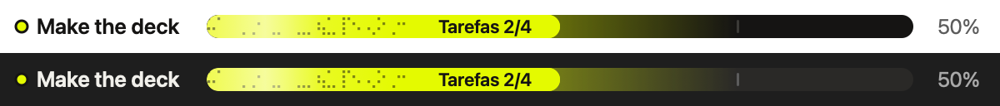

# brunoluzweb-ai-mods

Dez mods para o [Claude Code](https://claude.com/claude-code) pensados para o trabalho do dia a dia: escrever prompts melhores, ver o progresso das tarefas, não pagar a cache duas vezes, passar um chat longo para um novo, guardar correções como regras e travar o que o Claude ia enviar para fora.

Um mod é um plugin que muda o que o Claude Code mostra ou faz: uma barra acima do prompt, um painel lateral, um comando novo. Instalas só os que quiseres e ligas ou desligas cada um no painel `/mods`.



> O texto dos mods (botões, painéis, avisos) está em português de Portugal. Os comentários do código estão em inglês.

## Os mods

| Mod | O que faz | Comando |
| --- | --- | --- |
| **outbox** | Antes de o Claude enviar um email, mexer no calendário ou no Notion, mandar uma mensagem, fazer `git push` ou abrir um PR, segura a ação 5 segundos acima do prompt, com **Ver**, **Cancelar** e **Enviar já**. Se cancelares, nada sai e o Claude fica a saber que não deve tentar outra vez. | `/outbox` abre o painel *Enviado deste chat* |
| **helper-desk** | Uma barra de tarefas acima do prompt que avança à medida que o Claude risca a sua lista, e um painel lateral com um cartão ao vivo por subagente. | `/helpers` |
| **brain-dump** | Quando escreves (ou ditas) um prompt longo e solto, oferece-se para o transformar num brief em quatro partes: a tarefa, o porquê, os limites e o que conta como feito. Antes, faz até 3 perguntas sobre lacunas reais. | `/shape` liga ou desliga |
| **cache-clock** | Faz a contagem decrescente até a cache do chat arrefecer e diz quanto custa responder agora. O *Keep warm* mantém a cache quente com um pequeno ping em segundo plano. | `/cacheclock`, `/keepwarm` |
| **handoff** | Aos 250 mil tokens oferece *Refresh*: escreve um handoff do chat inteiro (o que foi pedido, feito e decidido, os ficheiros a abrir, os próximos passos) e copia-o ou abre um chat novo com ele. | `/refresh`, `/handoff` |
| **reflect** | Quando corriges o Claude, oferece-se para guardar a correção como regra permanente no `~/.claude/CLAUDE.md` ou numa pasta de notas tua. | `/reflect` liga ou desliga |
| **chat-inventory** | Um painel lateral, *Neste chat*, com a lista de tarefas, os conectores e as chamadas a cada um, os ficheiros de contexto e as skills que o chat usou. | `/inventory` |
| **screen-share** | Esconde emails, números de telefone, valores e nomes no ecrã enquanto gravas ou partilhas o ecrã. O Claude continua a ler os dados reais. | `/screen-share` |
| **replay-theater** | Percorre as edições de ficheiros que o Claude fez no último turno, um diff de cada vez. | `/replay` |
| **mods** | Um painel para ligar, desligar, mostrar ou esconder cada mod em todos os chats. Também encontra mods instalados de outros marketplaces. | `/mods` |

## Requisitos

- **Claude Code 2.1.309 ou mais recente** no terminal, ou o separador Code da app do Claude (testado com a 2.1.317). A API de mods ainda é *early access* e muda entre versões. Atualiza com `claude update`.
- **macOS.** O handoff usa `pbcopy` e `open` para copiar e abrir o chat novo, e o cache-clock precisa de `python3`. Os outros mods não dependem do sistema, mas só foram testados no macOS.

## Instalar

No terminal, adiciona o marketplace:

```bash
claude plugin marketplace add brunoluzweb/brunoluzweb-ai-mods
```

Depois instala os mods que quiseres, por exemplo:

```bash
claude plugin install outbox@brunoluzweb-ai-mods
```

Ou todos de uma vez:

```bash
for m in outbox helper-desk brain-dump cache-clock handoff reflect chat-inventory screen-share replay-theater mods; do claude plugin install "$m@brunoluzweb-ai-mods"; done
```

Dentro de uma sessão do Claude Code no terminal, também podes usar `/plugin install outbox --marketplace brunoluzweb/brunoluzweb-ai-mods`.

Na app do Claude, onde o `/plugin` não existe: carrega no **+** ao lado da caixa do prompt, depois **Plugins**, **Add marketplace** com `brunoluzweb/brunoluzweb-ai-mods` e **Add plugin**. Os mods instalados no terminal também correm nas sessões da app.

Em chats que já estavam abertos, corre `/reload-plugins`.

## Definições

Mudam-se com `/plugin configure <mod>@brunoluzweb-ai-mods` num terminal com o Claude Code. Todas têm um valor por omissão, por isso podes ignorá-las.

**outbox**

- `mode`: `countdown` (a barra com contagem decrescente, por omissão), `ask` (uma pergunta antes de cada envio) ou `log` (não segura nada, só regista no painel).
- `seconds`: 3, 5 (por omissão) ou 8 segundos de contagem.

O outbox deixa passar leituras, rascunhos e `git push --dry-run`. Numa sessão sem ninguém a ver (`claude -p`), não segura nada: só regista.

**reflect**

- `rules_folder`: a pasta onde **Guardar no vault** escreve cada regra como nota própria (por exemplo, uma pasta do Obsidian). Se ficar vazia, o reflect pergunta da primeira vez.

## Custos

Alguns mods fazem chamadas ao modelo por conta própria, pagas pela tua conta ou pela tua subscrição, como qualquer outra chamada do Claude Code:

- **brain-dump:** duas chamadas curtas (as perguntas e o brief), só quando aceitas transformar o prompt.
- **reflect:** quando uma mensagem tua parece uma correção, uma classificação rápida para o confirmar e, se for, uma chamada curta para escrever a regra.
- **handoff:** uma chamada que lê o chat inteiro a partir da cache, quando carregas em Refresh.
- **cache-clock:** com o Keep warm ligado, um ping por ciclo da cache, até 30 pings ou 2 horas. Cada ping lê o chat da cache por 5 a 10% do preço normal.

Os outros não fazem chamadas ao modelo.

## Onde ficam os dados

Tudo fica no teu computador, em `~/.claude`:

- `~/.claude/mods/switches.json`: os interruptores do `/mods`.
- `~/.claude/mods-logs/`: um log de erros por mod. É o primeiro sítio a ver quando um mod não faz o que devia.
- `~/.claude/mods-state/`: o estado que alguns mods guardam entre sessões, como as listas de tarefas do helper-desk.
- `~/.claude/handoffs/`: os handoffs escritos e o respetivo log.

## Desenvolver

Clona o repositório e adiciona a tua cópia como marketplace. Assim, o Claude Code lê os mods diretamente da pasta:

```bash
claude plugin marketplace add ./brunoluzweb-ai-mods
```

Depois de editares um mod, corre `/reload-plugins`. Se acrescentares um mod novo ao `.claude-plugin/marketplace.json`, corre antes `claude plugin marketplace update brunoluzweb-ai-mods`.

Para verificar um mod:

```bash
claude plugin validate plugins/outbox
```

Para correr os testes dele:

```bash
cd plugins/outbox && claude plugin test .
```

Cada mod tem a sua pasta em `plugins/`, com o manifesto em `.claude-plugin/plugin.json`, o código em `hooks/register.tsx` e os testes em `hooks/*.test.tsx`.

## Créditos

O **replay-theater** é o mod de exemplo da Anthropic em [anthropics/claude-code-playground](https://github.com/anthropics/claude-code-playground/tree/main/claude-code/mods/replay-theater), partilhado sob a licença Apache 2.0 (ver [`plugins/replay-theater/LICENSE`](plugins/replay-theater/LICENSE)). As alterações locais são o interruptor do `/mods`, a leitura da pasta pessoal a partir de `$HOME` e o texto em português.

As cores da barra do helper-desk e do outbox vêm da paleta da [UTU](https://brand.utu.wtf).
